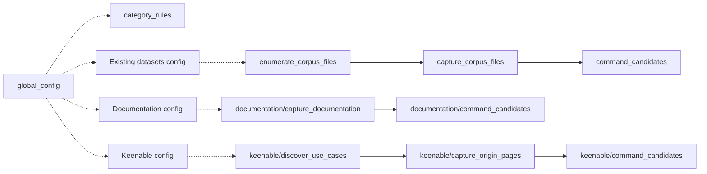
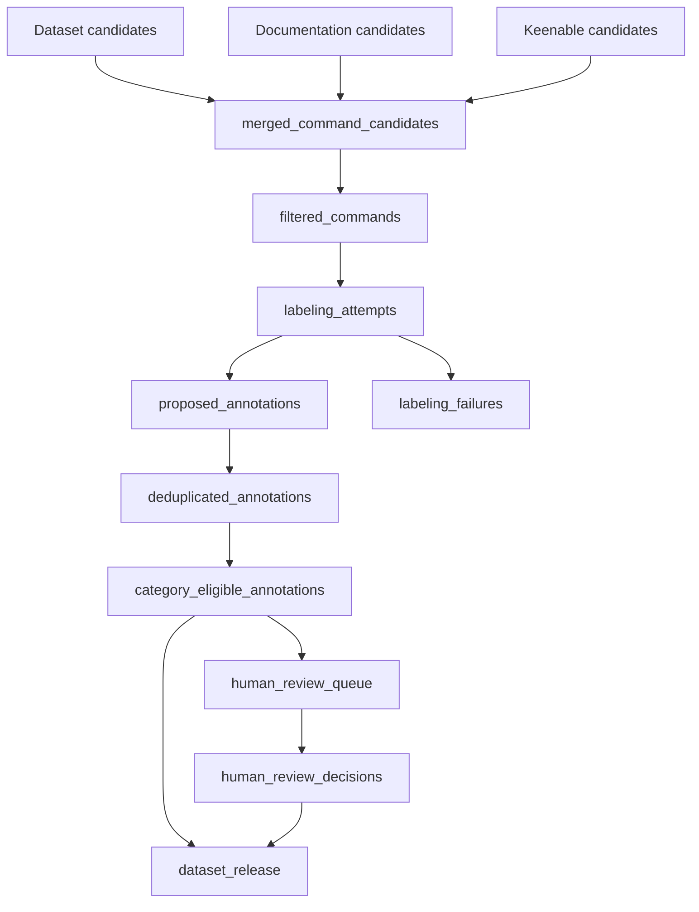

# CAT-3 Dagster flow

Three-branch collection design.
All three branches use the existing `dataset_builds` partition,
`cloud_infrastructure_commands_grounded_v1`. Solid lines carry persisted data;
dotted lines supply scoped configuration. Each branch has its own acquisition
boundaries. The [stage reference](../pipeline-stages.md) explains what to inspect.

Only Keenable searches for new origins. Its discovery output is a set of leads;
capture checks permission before retaining origin bytes. Repository branches use
reviewed pins instead. Configuration edges after the first stage are omitted
for clarity. Persisted prepared-manifest outputs are historical evidence.

The preparation-only selection stops at `filtered_commands`. Inside
`labeling_attempts`, the guarded batch labeler checks the candidate's command
against applicable passages in the verified origin captures. Source scopes,
license checks, searches and downloads belong to collection. An unsupported
operation remains unsupported without a second Keenable request. Candidates
are scheduled by descending source weight until each subrisk has 250 distinct
eligible all-high labels or its applicable input is exhausted.
The attempt retains row-specific snippets and receipts, or records an explicit
failure. Reuse requires the same relevant row inputs and still-authorized
evidence. The quota receipt distinguishes exhausted subrisks and commands
deferred without inference.

`semantic_evidence`, `labeling_documentation` and their config mappings have no
active nodes. Existing historical materializations and configs remain
immutable and readable; they do not feed the labeler.

Every shared stage also receives its own `map_<stage>_config` (omitted from
the second panel for readability). Only mappings that need policy receive
`category_rules`. An empty queue takes the policy completion path; a nonempty
queue requires real human decisions. The publication hold and exact-output
attestation are controls on the single release, not additional assets.
