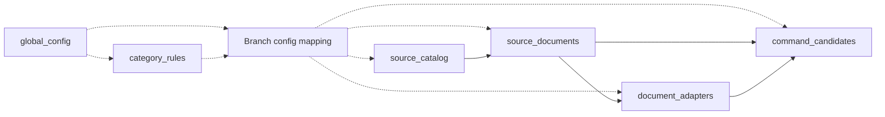
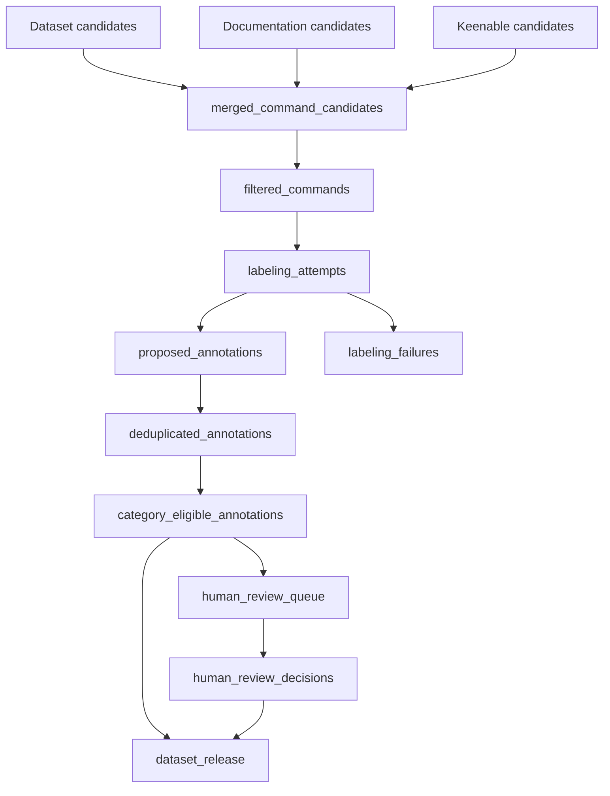

# Proposed CAT-3 Dagster flow

Three-branch collection design.
All three branches use the existing `dataset_builds` partition,
`cloud_infrastructure_commands_grounded_v1`. Solid lines carry persisted data;
dotted lines supply scoped configuration. The collection diagram is a template
instantiated three times. Exact keys and direct edges are specified in the
[increment's dependency table](cat3-collection-increment.md#asset-keys-and-direct-dependencies).

| Instance | Catalog | Documents | Adapter and candidates |
|---|---|---|---|
| Existing datasets | Enumerate eligible files from configured, pinned corpus origins. | Capture original bytes and verify integrity. | Apply the source's reviewed, hash-pinned Python ETL; retain the input position and transformation. |
| Documentation | Enumerate the configured documentation repositories and scopes. | Capture the pinned documents. | Extract examples and nearby explanations with document locations. |
| Keenable | Discover lead URLs through bounded queries from configured seeds and coverage questions. | Verify separately fetched origin bytes; a search result cannot authorize a row. | Extract permitted administrative examples with exact source spans, provenance and transformations. |

Only the Keenable collection catalog searches for sources. Its search and the
origin requests inside `source_documents` are runtime calls, not Dagster
assets. Source-driven acquisition uses the declared branch permissions;
historical prepared-source manifests remain readable.

The preparation-only selection stops at `filtered_commands`. Inside
`labeling_attempts`, the guarded batch labeler checks the candidate's command
against applicable passages in the verified origin captures. Source scopes,
license checks, searches and downloads belong to collection. An unsupported
operation remains unsupported without a second Keenable request. Candidates
are scheduled by descending source weight until each subrisk has 250 distinct
eligible all-high labels or its applicable input is exhausted.
The attempt retains row-specific snippets and receipts, or records an explicit
failure. Reuse requires the same relevant row inputs and still-authorized
evidence. The quota receipt distinguishes exhausted subrisks and commands
deferred without inference.

`semantic_evidence`, `labeling_documentation` and their config mappings have no
active nodes. Existing historical materializations and configs remain
immutable and readable; they do not feed the labeler.

Every shared stage also receives its own `map_<stage>_config` (omitted from
the second panel for readability). Only mappings that need policy receive
`category_rules`. An empty queue takes the policy completion path; a nonempty
queue requires real human decisions. The publication hold and exact-output
attestation are controls on the single release, not additional assets.
